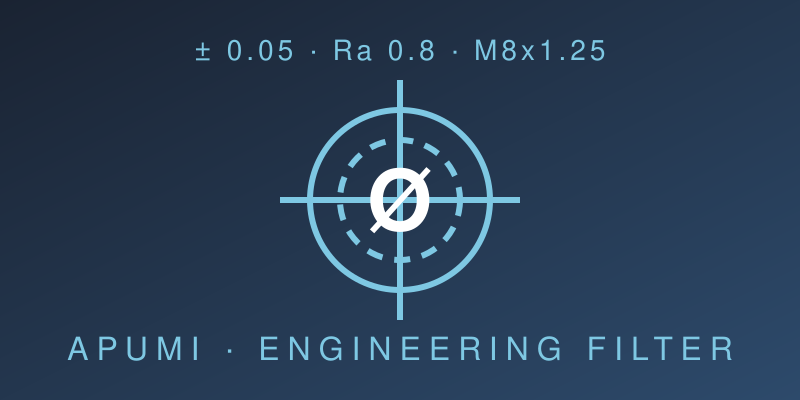

# Apumi

**Фильтр инженерных данных для LLM. Ø25 f7 и Ra 0.8 доходят до модели целыми.**

---

## За 30 секунд

**Что это:** Заменяет инженерные формулы плейсхолдерами до PII-маскирования и восстанавливает после. Формула доходит до модели, PII вырезается, инъекции блокируются.

**Кому:** Head of Engineering / CISO в precision engineering (Сингапур, ОАЭ).

**Почему сейчас:** Обычный PII-фильтр видит 12.5±0.05 как «цифры» и маскирует. Инженер получает бессмысленный ответ. Apumi различает формулу и телефон.

**Что доказано:** 612 строк, 6 международных стандартов (ISO 286, GB/T 1800, ISO 1302, ISO 261, ISO 2768, ASTM E140) — 100% сохранность, ноль провалов. 29 passed. _synthetic: false.

**Чего не доказано (честно):** Твёрдость HRC/HB — synthetic-only. NER (ФИО) — Stage 4.

---

## Оффер

Пилот €3–5K. Замер на данных клиента — критерий сохранности формул ≥95%.

**Следующий шаг:** Покажу замер на реальном корпусе ISO 286/GB/T 1800 — 20 минут.

---

## GitHub

- **Private code:** apumiaaifund/apumi
- **Public demo:** apumiaaifund/apumi-demo

## License

MIT

---

### 🚀 Что мы можем реализовать для партнёров на основе этого решения (Ниши и сценарии)

- **Enterprise AI и колл-центры:** локальный маршрутизатор и защитный контур для корпоративных LLM без утечки данных вовне.
- **Промышленность и банки:** развёртывание защищённого ИИ в закрытом контуре (On-Premise / Air-Gapped).

> **Формат сотрудничества:** запуск пилотного стенда (PoC) за 2–4 недели, лицензирование модуля (On-Premise) или кастомная интеграция под стек заказчика.  
> 📬 **Запросить демонстрацию и расчёт пилота:** [apumiaaifund@gmail.com](mailto:apumiaaifund@gmail.com)

---

### 🛡️ Верификация качества и безопасности (Apumia DevSecOps Gate)

> **Статус:** `VERIFIED & PROVEN` • **Дата аудита:** `16.11.2026`  
> **Контроль архитектуры (`Apumia Blueprint`):** `CLEAN` (`0` циклических зависимостей, контроль сложности McCabe)  
> **Анализ безопасности (`Bandit / Zero-Trust`):** `0` критических уязвимостей  
> **Протокол достоверности (`Apumia Hub`):** `_synthetic: false` | `preservation: 100.0%` | `verified: true`
